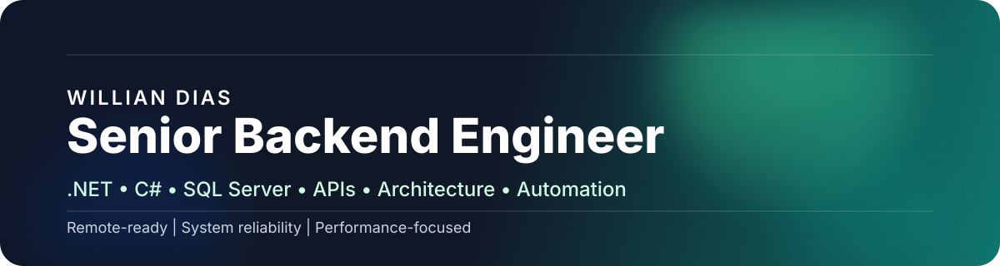

# Willian Dias

<a href="https://www.linkedin.com/in/williandias01/">LinkedIn</a> •
<a href="https://williandias1988.github.io/cartao_WillianDias/">Cartão</a> •
<a href="https://williandias1988.github.io/cartao_WillianDias/CV/Willian_Dias.pdf">Currículo</a> •
<a href="mailto:williandias01@gmail.com">Email</a>

## Sobre

Sou Desenvolvedor Backend Sênior .NET, com 8 anos em TI e mais de 5 em desenvolvimento de sistemas críticos. Comecei no suporte e na infraestrutura e hoje desenvolvo em C#, ASP.NET Core e SQL Server.

Já atuei no setor financeiro (Bradesco Financiamentos) e em operações de contact center de grande porte (AeC). Meu foco é software limpo, testado e fácil de operar, com atenção a performance e automação.

Busco oportunidades remotas como Desenvolvedor .NET Sênior ou Engenheiro de Software Backend.

## Destaques

- Robôs RPA em C# que reduziram em **30%** o tempo de tarefas críticas
- Otimização de SQL Server que melhorou a performance de relatórios
- Cobertura de testes elevada para **mais de 80%**
- Redução de **20%** no tempo de resolução de incidentes
- Sistemas em produção usados por milhares de usuários

## Stack

`C#` `.NET` `ASP.NET Core` `ASP.NET MVC` `Entity Framework` `SQL Server` `REST APIs` `Azure` `Azure DevOps` `Git` `Docker` `RPA` `Selenium` `AutoIt` `TDD` `Clean Architecture`

## Projetos

- [Portfolio](https://williandias1988.github.io/Portfolio/): portfólio pessoal
- [cartao_WillianDias](https://williandias1988.github.io/cartao_WillianDias/): cartão de apresentação profissional

## GitHub Stats

## Contato

- Email: `williandias01@gmail.com`
- Localização: Osasco, SP, Brasil
- LinkedIn: [williandias01](https://www.linkedin.com/in/williandias01/)
